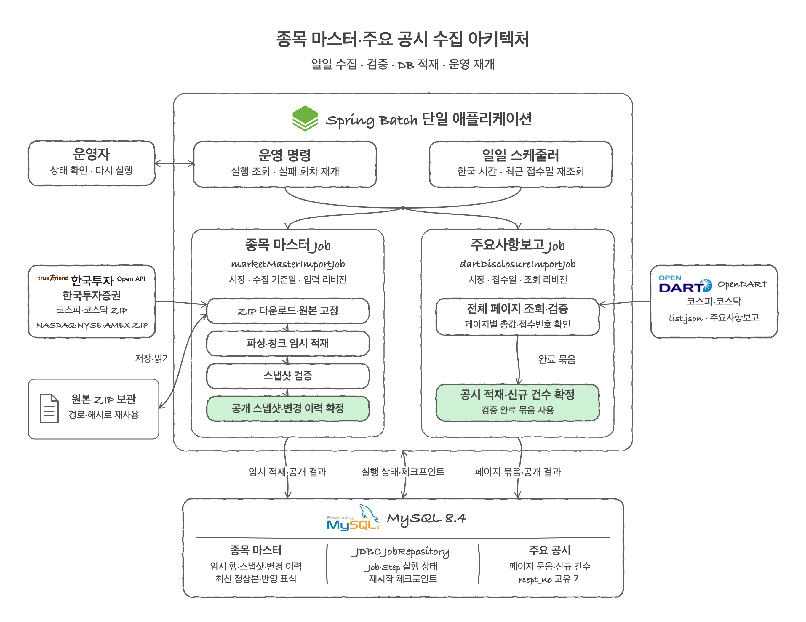
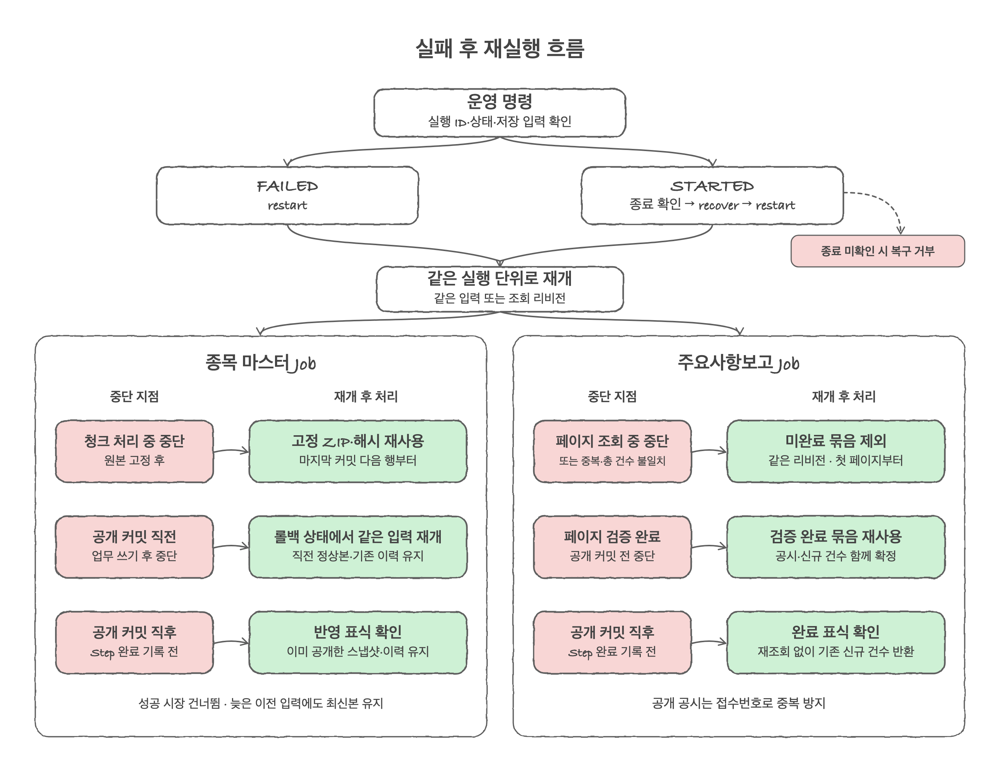

# 구현 계획 — 종목 마스터 동기화와 국내 주요 공시 수집

작성일 `2026-11-25` · 입력 [기능 명세](spec.md) · [PRD](PRD.md)

## 1. 요약과 기술 환경

한국투자증권은 시장별 Job으로 다섯 시장의 파일을 검증하고 최신 목록과 변경 이력을 반영한다. OpenDART는 별도 Job으로 두 시장의 주요사항보고를 접수일별로 수집하고 접수번호 기준으로 적재한다. 두 Job의 시장별 성공·실패를 독립적으로 기록하고, 일일 스케줄은 한국 시간을 기준으로 한다.

- **구현 기준 제안** — Java 21, Spring Boot 4.2.0, Spring Batch 6.1.0, MySQL 8.4와 JDBC. Boot 4.2.0의 관리 의존성은 Batch 6.1.0을 제공한다. [Spring Boot 관리 의존성 표](https://docs.spring.io/spring-boot/appendix/dependency-versions/coordinates.html)
- **실행 저장소** — MySQL에 JDBC `JobRepository`를 사용해 Job·Step 실행 상태와 재시작 컨텍스트를 보존한다. 서비스 데이터와 배치 메타데이터에는 같은 데이터소스와 트랜잭션 관리자를 사용하는 구성을 기본으로 잡는다. [Spring Batch JDBC JobRepository](https://docs.spring.io/spring-batch/reference/job/configuring-repository.html) · [Spring Batch ItemStream](https://docs.spring.io/spring-batch/reference/readers-and-writers/item-stream.html)
- **구성 원칙** — 단일 Java 애플리케이션 안에서 회차 실행, 한국투자증권 다운로드·파싱·스냅샷 반영, OpenDART 공시 조회·적재를 구분한다. 원본 ZIP과 검증을 마친 공시 페이지는 재시작 후에도 접근할 수 있도록 보관한다. 작업 규칙은 저장소의 [AGENTS.md](../../AGENTS.md)를 따른다.

### 전체 아키텍처

## 2. 시장별 수집·검증·적재 Job

스케줄러는 회차의 다섯 시장 실행을 등록하고 `marketMasterImportJob`을 시장별로 호출한다. 한 시장에서 실패해도 다음 시장을 실행하며, 회차에는 시장별 상태를 집계한다. 첫 출시는 시장 간 순차 실행으로 시작한다. `market`, `collectionDate`, `inputRevision`을 식별 `JobParameters`로 사용해 각 시장과 입력 리비전마다 독립된 `JobInstance`를 만든다. [Spring Batch JobInstance와 JobParameters](https://docs.spring.io/spring-batch/reference/domain.html#jobinstance)

| Step | 방식 | 처리와 완료 기준 |
| --- | --- | --- |
| `downloadArchive` | Tasklet | PRD의 시장별 URL에서 ZIP을 받는다. 임시 저장 후 압축 유효성과 예상 내부 파일명을 확인하고 원본 경로·해시·수집 시각을 기록한다. 원격 파일을 받는 동안 시장 반영 잠금은 잡지 않는다. [Spring Batch TaskletStep](https://docs.spring.io/spring-batch/reference/step/tasklet.html) |
| `stageInstruments` | Chunk | 고정한 파일의 행을 읽어 코스피·코스닥 개별 규격과 미국 공통 규격으로 파싱한다. 지원 유형, 필수값과 코드 형식을 검사하고 임시 적재 영역에 쓴다. 체크포인트는 마지막 커밋 위치까지 보존한다. [Spring Batch Chunk 처리](https://docs.spring.io/spring-batch/reference/step/chunk-oriented-processing.html) · [ItemStream 체크포인트](https://docs.spring.io/spring-batch/reference/readers-and-writers/item-stream.html) |
| `validateSnapshot` | Tasklet | 지원 대상이 비어 있는지, 시장 내 식별자가 중복되는지, 직전 정상본 대비 유효 건수가 비정상적으로 줄었는지 확인한다. 실패 사유와 건수를 남기고 해당 시장 공개를 중단한다. |
| `publishSnapshot` | Tasklet | 시장 상태 행을 `SELECT … FOR UPDATE`로 잠근 뒤 현재 정상본을 기준으로 건수 조건을 다시 확인하고 변경을 계산한다. 변경 이력, 최신 스냅샷 참조, 반영 완료 기록을 한 트랜잭션에서 함께 확정한다. [MySQL 8.4 잠금 읽기](https://dev.mysql.com/doc/refman/8.4/en/innodb-locking-reads.html) · [Spring Batch Tasklet 트랜잭션](https://docs.spring.io/spring-batch/reference/step/tasklet.html) |

임시 적재의 고유 키는 실행 입력과 **원본 행 번호**를 기준으로 둔다. 재실행한 같은 행은 재사용할 수 있고, 다른 행에 동일 식별자가 나오면 전체 검증에서 중복으로 검출한다. 국내·미국의 주식·ETF·ETN을 정규화하되 원본 유형 코드와 상품 구분은 문자열로 보존한다. 지원 대상에 해당하는지 판단할 수 없는 코드나 형식은 검증 오류로 표시한다. 형식과 원본 필드는 [PRD의 공식 입력 파일](PRD.md#4-공식-입력-파일과-제공-필드)을 따른다.

최초 공개 시 비교 기준을 만든다. 이후 정상본은 직전 정상본과 비교해 변화만 기록한다. 동일한 데이터로 다시 수집한 회차는 정상 수집 시각을 기록하며 새 변경을 만들지 않는다. `목록에서 미확인`과 `재등장`은 이전 공개 기록을 통해 구분한다.

운영 조회에서는 회차 식별 정보, 처리 건수, 검증 결과, 마지막 정상 수집 시각과 확인 가능한 원천 효력일을 조회한다. 원천 효력일은 별도 필드로 저장하고 확인할 수 없으면 미확인으로 표시한다.

## 3. 실패 후 재실행과 DB 일관성

- **입력 고정** — 원본을 확보한 이후에는 동일 `JobInstance`의 저장된 경로·해시·파서 규격으로 재시작한다. 확보 전에 실패한 경우에는 그 단계에서 내려받는다. 저장한 원본이 잘못돼 새 파일이 필요하면 `inputRevision`을 올려 별도 입력으로 기록한다. 새 입력은 이전 파일의 체크포인트를 사용하지 않는다. [Spring Batch JobInstance와 재시작 상태](https://docs.spring.io/spring-batch/reference/domain.html#jobinstance) · [Spring Batch ItemStream](https://docs.spring.io/spring-batch/reference/readers-and-writers/item-stream.html)
- **시장별 재개** — 이미 성공한 시장 인스턴스는 다시 실행하지 않는다. 실패한 시장은 기존 실행을 재시작하고 기본 Step 정책에 따라 완료한 단계 이후부터 이어간다. 프로세스가 실제 종료됐는데 메타데이터가 `STARTED`에 남은 경우에는 종료와 체크포인트를 확인한 뒤 `JobOperator.recover`와 `restart`를 사용한다. [Spring Batch 완료 Step과 재시작](https://docs.spring.io/spring-batch/reference/step/chunk-oriented-processing/restart.html) · [Spring Batch 강제 종료 복구](https://docs.spring.io/spring-batch/reference/job/advanced-meta-data.html#recovering-a-job)
- **중복·역순 반영 방지** — 공개 트랜잭션이 이미 커밋된 실행은 그 안에 기록한 반영 완료 표식으로 판별한다. 시장 잠금 안에서 `(수집 기준일, 입력 리비전)`을 비교해 더 최신 정상본이 있으면 해당 실행의 결과를 운영 이력에만 기록한다. 종목 변경 이력은 실제 공개된 스냅샷에만 연결한다. [MySQL 8.4 잠금 읽기](https://dev.mysql.com/doc/refman/8.4/en/innodb-locking-reads.html)
- **운영 재개** — 애플리케이션 운영 명령에서 KIS의 시장·수집 기준일·입력 리비전 또는 OpenDART의 시장·접수일·조회 리비전으로 Job 실행 ID, 저장된 입력 식별 정보, 현재 상태와 실패 단계를 조회한다. 이 식별자로 기존 실행을 선택해 재개한다. 강제 종료 복구는 기존 작업 프로세스가 종료됐는지 운영 환경에서 확인한 뒤 요청하며, 실행 중이거나 종료가 확인되지 않은 경우에는 복구를 거부한다. 검증·적재 실패 상태는 업무 반영 트랜잭션의 롤백과 별도로 운영 조회에 남긴다.
- **공개 커밋 경계** — KIS는 같은 입력에 공개 스냅샷을 한 건만 연결한다. 공개 커밋 전 중단에서는 스냅샷·이력·최신 참조·정상 수집 시각·반영 표식을 함께 롤백한다. 커밋 후 Step 완료 기록 전 중단에서는 반영 표식을 확인해 기존 결과를 재사용한다. [Spring Batch Tasklet 트랜잭션](https://docs.spring.io/spring-batch/reference/step/tasklet.html)

### 실패 후 재실행 흐름

### 주요 데이터와 고유 키

| 데이터 | 키 또는 관계 | 보관할 내용 |
| --- | --- | --- |
| 회차·시장 입력 | `(collection_date, market, input_revision)` | 원본 파일 참조·해시·파서 규격, 수집 시각과 확인 가능한 원천 효력일, 처리 건수, 검증 결과, 오류와 반영 상태 |
| 공개 스냅샷 | 회차·시장 입력과 1대1 고유 관계 | 반영 완료 표식에 연결되는 공개 스냅샷 식별자 |
| 스냅샷 종목 | `(snapshot_id, market, symbol)` | 종목명, 정규화한 유형, 원본 증권·상품 코드, 시장에서 제공하는 상태값 |
| 시장 상태 | `market` | 최신 정상 스냅샷 참조, 마지막 정상 수집 시각과 마지막 시도 결과 |
| 변경 이력 | `(published_snapshot_id, market, symbol, change_type, field)` | 변경 전후 값, 원본 수집 시각과 공개 시점. 값 비교가 없는 상태 변경의 `field`는 일정한 값으로 둔다. |
| 공시 수집 시도 | `(receipt_date, market, scan_revision)` | 페이지 검증 결과, 조회 시각, 신규 적재 건수, 상태와 오류 |
| 공시 페이지 묶음 | 수집 시도 안의 조회 차수와 페이지 번호 | 검증 기준 건수, 수집 페이지, 완료된 묶음 참조. 공개 시 같은 수집 시도의 검증 완료 묶음만 읽는다. |
| 공시 | `rcept_no` 기본 키 | 접수일, 시장, 종목코드, 회사명, 보고서 제목. 원문 링크는 접수번호로 생성한다. |

## 4. OpenDART 주요사항보고 수집 Job

`dartDisclosureImportJob`을 `(접수일, 시장, 조회 리비전)`으로 식별한다. 일일 스케줄은 코스피·코스닥의 해당 접수일과 최근 재조회 대상일을 각각 실행한다. 실패한 인스턴스는 같은 리비전으로 재시작하고, 이미 완료된 날짜를 다시 확인할 때는 새 조회 리비전을 만든다.

| Step | 처리와 완료 기준 |
| --- | --- |
| `fetchDisclosurePages` | `list.json`에 `bgn_de=end_de=접수일`, `pblntf_ty=B`, `last_reprt_at=N`과 해당 시장의 `corp_cls=Y` 또는 `K`를 넘긴다. `page_no`와 응답의 `total_page`를 사용해 전체 페이지를 이어 읽고 검증한다. 인증키(`crtfc_key`)는 실행 설정에서 주입한다. [OpenDART 공시검색 요청·응답](https://opendart.fss.or.kr/guide/detail.do?apiGrpCd=DS001&apiId=2019001) |
| `publishDisclosures` | 검증을 마친 페이지의 공시를 적재하고 수집 시도의 성공 상태와 신규 적재 건수를 같은 트랜잭션에서 확정한다. 이미 적재한 접수번호는 신규 집계에서 제외한다. 같은 접수번호가 재실행이나 다른 조회에 포함돼도 고유 키로 중복을 막는다. 같은 시도가 이미 확정됐다면 기록된 결과를 반환한다. |

- **정상과 장애 구분** — OpenDART는 `000`을 정상, `013`을 조회 데이터 없음, `020`을 요청 제한 초과로 정의한다. 첫 페이지의 `013`은 0건 성공으로 기록한다. 페이지 중간의 빈 응답, 요청 제한이나 기타 오류는 해당 시장·접수일의 미완료로 기록한다. [OpenDART 상태 코드](https://opendart.fss.or.kr/guide/detail.do?apiGrpCd=DS001&apiId=2019001)
- **페이지 완료 판정** — 같은 조회 차수에서 페이지 크기와 정렬을 고정한다. 첫 정상 응답의 `total_page`와 `total_count`를 기준으로 모든 페이지의 총값이 일치하고, 요청한 페이지 번호가 빠짐없이 돌아오는지 확인한다. 시장·접수일·접수번호를 검증하고, 묶음 안에서 접수번호가 반복되거나 마지막 페이지까지 모은 고유 접수번호 수가 총 건수와 다르면 미완료로 처리한다. [OpenDART 페이지 요청·응답 필드](https://engopendart.fss.or.kr/guide/detail.do?apiGrpCd=DE001&apiId=AE00001)
- **페이지 재실행** — 미완료 묶음은 공개 대상에서 제외하고 같은 `scanRevision` 안의 새 조회 차수로 첫 페이지부터 다시 요청한다. 전체 검증을 마쳐 완료 표식을 커밋한 묶음은 공개 전후 장애에서 재사용한다. 완료된 날짜를 새 리비전으로 조회할 때 이미 공개된 접수번호는 정상 입력으로 받아 중복 적재 없이 처리한다.
- **최근 접수일 보완** — 페이지 수와 건수가 같고 중복 접수번호도 없는 상태에서 조회 중 구성원만 바뀌는 경우는 한 번의 순회로 판별하기 어렵다. 최근 접수일 재조회로 뒤늦게 나타난 접수번호를 추가한다.
- **강제 종료 복구** — `STARTED`에 남은 실행은 운영자가 이전 프로세스 종료와 저장 상태를 확인한 뒤 `JobOperator.recover`와 `restart`로 같은 시장·접수일·`scanRevision`을 복구한다. 자동 재조회 범위 밖의 날짜도 운영 명령에서 지정할 수 있다. 완료된 페이지 묶음이 없으면 첫 페이지부터 다시 읽고, 묶음만 완료됐다면 이를 사용해 공개한다. 공개까지 커밋됐다면 기존 완료 상태와 신규 건수를 반환한다. [Spring Batch 강제 종료 복구](https://docs.spring.io/spring-batch/reference/job/advanced-meta-data.html#recovering-a-job)
- **조회 기준** — `rcept_no`를 문자열로 저장하고 제목의 정정 표기를 유지한다. 종목 마스터와의 연결 여부와 관계없이 대상 공시를 저장한다. 공시의 신규 건수·제목·원문 링크와 종목 변경 이력은 운영 조회에서 확인한다.

## 5. 검증 계획과 남은 결정

| 명세 | 검증 |
| --- | --- |
| FR-001 ~ FR-004, SC-001 | 시장별 정상 ZIP과 손상 ZIP을 로컬 HTTP로 제공한다. 시장별 포맷, 한글과 선행 0, 주식·ETF·ETN 코드, 중복·빈 파일·건수 감소와 원천 효력일 유무에 따른 조회 결과를 확인한다. |
| FR-004 ~ FR-006, SC-002 | MySQL에서 시장별 실패 격리, 청크 커밋 후 중단, 이전 회차의 늦은 재개를 확인한다. 실제 변경이 있는 입력의 공개 커밋 전과 커밋 후 Step 완료 기록 전에 각각 중단한다. 재개 후 입력당 공개 스냅샷 수, 종목 집합, 최신 참조, 변경 전후 값과 반영 표식을 중단 없는 실행과 대조한다. |
| FR-006 | 최초 정상본, 동일 데이터, 여러 유형의 이름 변경, 목록 미확인·재등장에서 시장별 변경 이력을 검증한다. |
| FR-007 ~ FR-008, SC-003 | 로컬 응답에서 여러 페이지와 정정 공시, 완료 후 동일 접수번호 재조회, 늦게 추가된 공시를 시험한다. 페이지 수와 총 건수가 같은 상태로 페이지 경계의 접수번호를 중복시키거나 수집 건수를 총 건수보다 작게 만들어 공개가 차단되는지 확인한다. 복구 후 이전 미완료 묶음의 행을 섞지 않고 기대 접수번호 집합을 적재해야 한다. |
| FR-009, SC-004 | 첫 페이지 0건, 중간 페이지 실패, 요청 제한과 공개 커밋 전 오류를 각각 시험한다. 별도 JVM을 페이지 조회 중과 공개 커밋 후 Step 완료 기록 전에 각각 강제 종료해 `STARTED`를 재현한다. 같은 리비전으로 재개한 뒤 기대 공시 집합과 기록된 신규 건수를 비교한다. |

- **기능 구현 전** — KIS 건수 감소율이 설정 한도를 초과하면 공개를 차단한다. OpenDART는 타임아웃·일시적 서버 오류에만 요청 단위 지연 재시도를 제한 횟수로 적용한다. 요청 제한과 검증 실패는 해당 조회를 미완료로 기록한다. 두 기준을 외부 설정으로 받고 통합 시험용 고정값을 공통 준비에서 정한다.
- **일일 실행 활성화 전** — 실제 파일의 헤더·열 수를 파서 작업에서 확인한다. 일일 실행 시각, 건수 감소 운영값, 원본 보존 기간, 공시 재조회 범위와 재시도 운영값을 실제 파일·응답으로 확인한다. 외부 연결 점검을 로컬 통합 시험과 분리하고, KIS 변경 이력까지 연결한 복구 시험과 양 소스 일일 통합 시험을 통과한 뒤 스케줄을 활성화한다.
